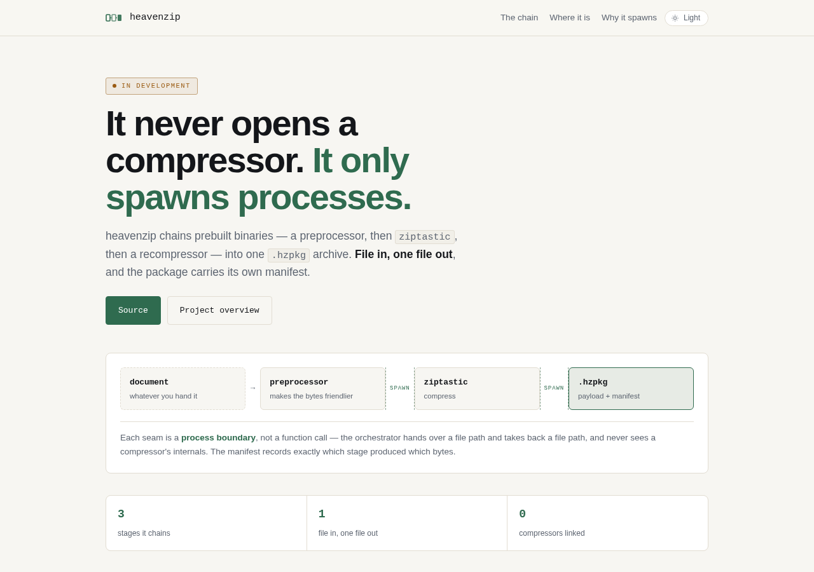

# heavenzip



<p>
  
  
  
  
  
  
</p>

CHCE orchestrator - chains prebuilt binaries

> **Status: phase 7 done — the plan's phases are complete.** CLI, INI parser,
> detector, planner, dispatcher, manifest, external-process tier, bench harness and
> the two reference documents. 9 ctest suites in CI, including a round trip through
> the real ziptastic release binary and a test that the worked example in
> `docs/PROFILES.md` actually works.
>
> Classification is by content, never extension: magic bytes for media and
> archives, then a printable-ratio test that accepts valid UTF-8, so prose in
> Devanagari is text and a ZIP renamed to `.txt` is still an archive. The read is
> bounded at 64 KiB.
>
> `compress` writes `<input>.hzpkg` and `<input>.hzpipeline`; the manifest records
> every step's argv **and** the command that reverses it. A step that fails stops
> the run, keeps its logs, and the manifest is still written with `"ok": false`. A
> missing binary is refused before the input is touched.

## Quick start

```bash
# 1. get an engine into bin/ (the sync-binaries workflow does this in CI)
gh release download -R drsamonline/ziptastic --pattern 'ziptastic-*-linux-x86_64' --dir bin/

# 2. see what the shipped profiles would do
heavenzip validate
heavenzip list-profiles

# 3. plan, then run
heavenzip compress notes.txt --dry-run
heavenzip compress notes.txt
heavenzip decompress notes.txt.hzpkg --out restored.txt

# 4. measure every profile against a corpus
heavenzip bench tests/fixtures/

# 5. let it find the best combination for one file, and keep it as a profile
heavenzip autotune big-corpus.tar
heavenzip autotune big-corpus.tar --write best-for-tarballs --goal ratio

# 6. or write all three trade-offs at once and pick with your eyes
heavenzip autotune big-corpus.tar --templates ./templates
```

`compress` verifies its own output by default: it reverses the archive it just
wrote and compares the bytes, because an exit code of 0 is not proof. `paq8px -8`
runs out of memory, writes a 14-byte stub and returns 0 — with verification off,
that archive would have been handed over as a success. `--no-verify` skips the
check when the time matters more.

`autotune` runs the combinations the tools in `bin/` make possible, ranks them by
measured size, and then proves each one by reversing it — smallest first — so a
candidate that cannot restore its own output is reported rather than ranked.

It reports three winners, because "best" is two questions. On a 120 KB file:

| goal | pipeline | ratio | time |
|---|---|---|---|
| smallest | `paq8` | 0.1776 | 31.0 s |
| fastest | `z9` | 0.1927 | 0.31 s |
| balanced | `z9` | 0.1927 | 0.31 s |

100× the time for 8 % of the size is a trade a person should make deliberately, not
a number to be handed. `--goal` picks which one `--write` saves; `--templates <dir>`
writes `best-ratio.ini`, `best-speed.ini` and `best-balanced.ini` side by side.

## Before you change anything

`docs/TRAPS.md` — ten traps this repository has already sprung, including the ones
that only appear in a release artefact and the ones that fail silently in CI.

## Build plan

The plan has eight phases (`AGENT_PROMPT.md` §12 asks for this table to be kept
here after every phase; it was not, and the prose above drifted away from it).

| Phase | Status | Notes |
|---|---|---|
| 0 | done | CLI skeleton, INI parser |
| 1 | done | content detector — magic bytes, then a printable-ratio test |
| 2 | done | profile matcher, dry-run dispatcher |
| 3 | done | real dispatcher: spawns each step, keeps logs, stops on failure |
| 4 | done | ziptastic integration; `<input>.hzpipeline` manifest with reverse args |
| 5 | done | external-process tier — steps whose binary is not ziptastic |
| 6 | done | `validate`, and the bench harness |
| 7 | done | `docs/PROFILES.md`, `docs/PIPELINE.md` |

## What ships

A default release carries one binary: ziptastic, fetched by `sync-binaries`. The
shipped profiles name three more — `srep`, `preflate`, `paq8px` — and the decision
on which of those a release may ever include, and what a profile does when one is
absent, is written down in [docs/PACKAGING.md](docs/PACKAGING.md).


## Profile catalog

| Profile | detect | Pipeline | What it is for |
|---|---|---|---|
| `text` | `text` | srep → ziptastic `-c lzma -9` | prose, logs, source |
| `media` | `media` | preflate → ziptastic `-c brotli -q 11` | photos, PDFs, audio |
| `max-ratio` | `any` | srep `-m5f` → paq8px `-8` | last resort, slow and small |

Writing another one is a file, not a patch: [docs/PROFILES.md](docs/PROFILES.md).
How a payload is made and undone: [docs/PIPELINE.md](docs/PIPELINE.md).

## Support


Free, offline, accountless — and staying that way. If it earned its keep:

| | |
|---|---|
| UPI (India) | `drsohilboi@ybl` — payee Dr. Sohil Momin, open amount, or scan [the QR](docs/assets/upi-qr.svg) |
| GitHub Sponsors | [github.com/sponsors/drsamonline](https://github.com/sponsors/drsamonline) |
| Ko-fi | [ko-fi.com/matneo](https://ko-fi.com/matneo) |
| PayPal | [paypal.me/drsohilmomin](https://paypal.me/drsohilmomin?locale.x=en_GB&country.x=IN) |
| My books | [Amazon author store](https://www.amazon.com/stores/author/B08ZT331LY/allbooks?ccs_id=aed72b9f-71d9-41dc-adee-e9368a317acc) |
| More apps | [drsamonline.github.io](https://drsamonline.github.io/) |
| Email | [sohilmomin2000@gmail.com](mailto:sohilmomin2000@gmail.com) |

Nothing is gated behind it: no accounts, no tracking, no network requests.
