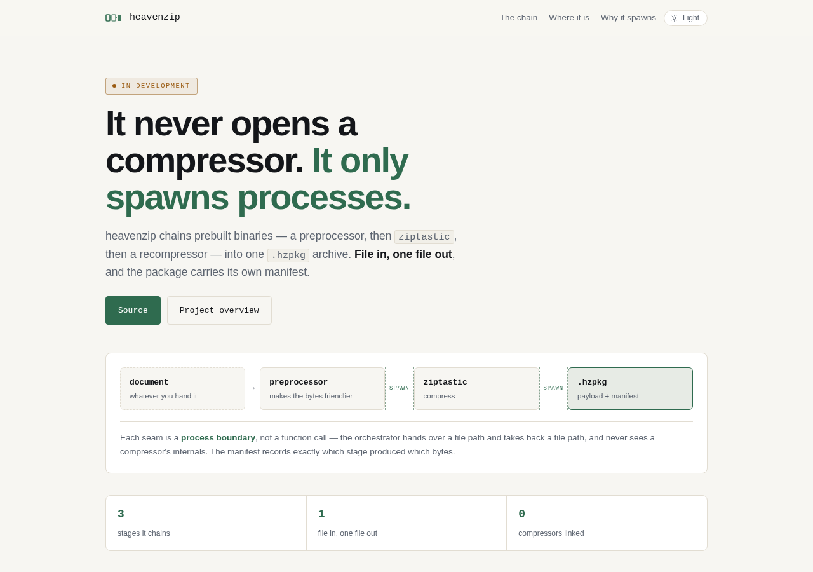
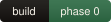
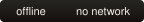
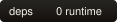

# heavenzip

  
  
  
  
  
  

CHCE orchestrator - chains prebuilt binaries

> **Status: phase 0 — the repository is a plan.** `src/`, `bin/` and `tests/`
> are empty placeholders; there is no `CMakeLists.txt` and nothing to build yet.
> The badges above are drawn by `tools/badges.py` from what is actually in the
> tree, so they say so. `AGENT_PROMPT.md` §8 is the phase plan, and phase 0 is
> the CLI skeleton plus the INI parser.

## Support

Free, offline, accountless — and staying that way. If it earned its keep:

| | |
|---|---|
| UPI (India) | `drsohilboi@ybl` — payee Dr. Sohil Momin, open amount, or scan [the QR](docs/assets/upi-qr.svg) |
| GitHub Sponsors | [github.com/sponsors/drsamonline](https://github.com/sponsors/drsamonline) |
| Ko-fi | [ko-fi.com/matneo](https://ko-fi.com/matneo) |
| PayPal | [paypal.me/drsohilmomin](https://paypal.me/drsohilmomin?locale.x=en_GB&country.x=IN) |
| My books | [Amazon author store](https://www.amazon.com/stores/author/B08ZT331LY/allbooks?ccs_id=aed72b9f-71d9-41dc-adee-e9368a317acc) |
| More apps | [drsamonline.github.io](https://drsamonline.github.io/) |
| Email | [sohilmomin2000@gmail.com](mailto:sohilmomin2000@gmail.com) |

Nothing is gated behind it: no accounts, no tracking, no network requests.
